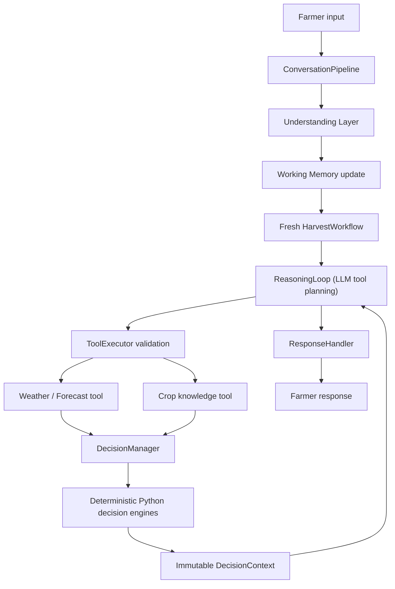

# Harvest Agent architecture

## Request lifecycle

Each `AgentEngine.run()` starts a fresh conversation session and creates a new
`HarvestWorkflow`. Working, semantic, and episodic memory remain owned by the
engine and survive between requests. The bounded `ConversationMemory` retains
only the system prompt and the most recent messages for the current request.

## Deterministic decision flow

1. The understanding layer determines `harvest_decision` or `harvest_forecast`
   and updates working memory with supplied crop and city facts.
2. Reflection validates that crop and city are available, including facts loaded
   from working memory.
3. The LLM may plan tool calls only. `ToolExecutor` validates their names and
   argument types before dispatch.
4. `DecisionManager` runs only after valid crop information and the weather data
   required by the intent are available. It rejects error payloads.
5. For current requests it calls `evaluate_harvest`; for forecast requests it
   calls `find_best_harvest_day`, which scores every eligible forecast day.
6. The resulting decision is stored in `HarvestWorkflow` and inserted as an
   immutable system message before the LLM's final explanation.
7. `ResponseHandler` prefixes the final explanation with the authoritative
   deterministic decision. A harvest request cannot complete before Python has
   produced a decision.

This pattern is reusable by Climate, Storage, Logistics, Market, Disease, and
Equity agents: substitute the workflow, tool registry, and deterministic
decision engine while retaining the runtime pipeline.
